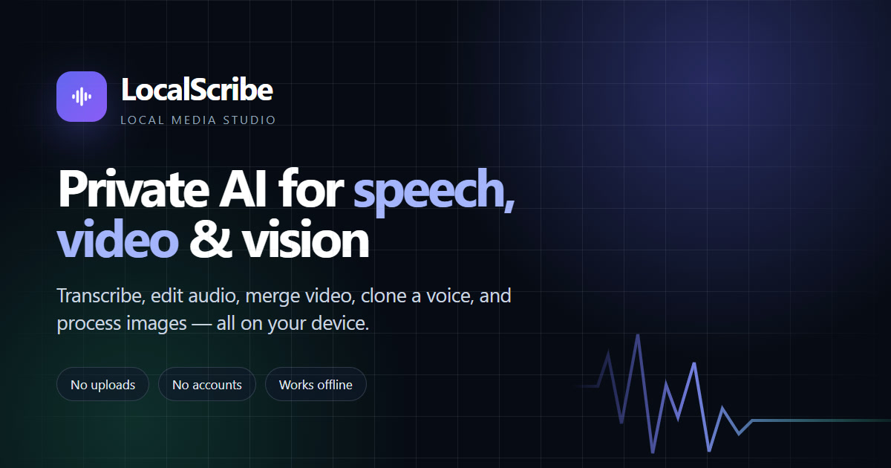

# LocalScribe



[](LICENSE)
[](https://bun.sh)
[](docs/FEATURES.md)

A privacy-first media studio that runs in the browser. Transcribe speech, edit audio, cut video, clone a voice, and process images on your own device. There is no backend, no account, and no analytics.

The app shell and runtimes ship with the site. Model weights download once into browser cache, after which the tools work offline.

## What is inside

| Tool | What it does |
| --- | --- |
| Audio to text | Local speech recognition, streaming transcript, segment list, language presets, batch queue, and editable exports |
| Text to speech | Six local engines, voice gallery, streaming playback, and MP3, WAV, OGG, FLAC, M4A, WebM, or Opus output |
| Audio studio | Vocal removal, stem separation, pitch, tempo, cuts, effects, lyrics, joiner, recorder, and multi-step undo |
| Video editor | Multi-track timeline, filmstrips, waveforms, captions, effects, keyframes, proxies, project save and load, and local export |
| Screen recorder | Screen, tab, or camera capture with microphone and system audio |
| Quick tools | Local converters, trims, frame extraction, image edits, and batch jobs |
| Vision studio | Background removal, depth, detection, segmentation, classification, and captioning |
| Documents and privacy | OCR, redaction, metadata stripping, checksums, and clean file batches |
| Models and storage | Model picker, cache state, device fit, quota view, and cache controls |

Every job runs in the tab or in a local worker. The service worker caches the app for repeat visits, and a privacy receipt shows request destinations and response sizes without logging media or text.

## Quick start

Bun is the only supported runtime. Do not use npm, npx, or node.

```sh
bun install
bun run dev
```

Open the local URL printed by Vite. To check a production build:

```sh
bun run build
bun run preview
```

Run the checks before sending changes:

```sh
bun test
bun run typecheck
```

## Repository layout

- `src/`: app shell, tool modules, workers, and local inference code
- `tests/`: Bun tests
- `bench/`: reproducible load, media, video, and model benchmarks
- `docs/`: detailed feature guide and design notes
- `public/`: static assets, sample media, model files, and social images
- `scripts/`: build and SEO helpers
- `seo/`: generated page sources
- `.github/workflows/`: GitHub Pages deployment
- `AGENTS.md`: contributor rules

## Documentation

- [Detailed feature guide](docs/FEATURES.md)
- [Performance runbook](bench/PERF-RUNBOOK.md)
- [Media engine plan](docs/media-engine-plan.md)
- [Model radar](docs/model-radar-2026-11.md)
- [Browser video editors](docs/browser-video-editors-2026-11.md)
- [Quick tools verification](docs/quick-tools-verification.md)
- [Third-party notices](NOTICE)

## Benchmarks

The benchmark scripts live in `bench/` and are run with Bun. See the runbook for setup and baselines.

```sh
bun run bench:load
bun run bench:video
bun run bench:media
bun run bench:mel
bun run bench:seo
```

## Privacy and licenses

LocalScribe is MIT licensed. Some models and runtimes carry their own terms, including non-commercial voice models. Those credits and license links are collected in [NOTICE](NOTICE).

No upload path exists in the app. Only model weight downloads go to external hosts, and the receipt view reports them by destination and size.
