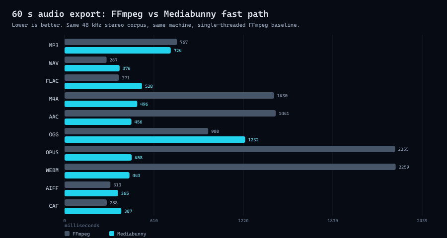

# Media engine benchmarks

Date: 2026-11-21

Machine: Windows, 16 logical cores, Chrome/Electron 152, cross-origin isolated. The
FFmpeg runs forced the single-threaded core because this working tree does not currently
serve the multithreaded `ffmpeg-mt` assets. Absolute numbers will differ on other
machines; the direction and the load-avoidance result are the point.

Corpus: 48 kHz stereo, 10 s and 60 s of a 523.25 Hz sine plus low-level pink noise.
`benchmarks/generate-corpus.ps1` recreates it in `public/bench/` (git-ignored). The corpus
is deleted before a production build so it never ships.

Harnesses:

- `bench-media.html` + `src/bench-baseline.ts` — baseline FFmpeg path.
- `bench-compare.html` + `src/bench-compare.ts` — router + direct Mediabunny path.
- Raw results: `benchmarks/baseline-ffmpeg.json` and
  `benchmarks/after-mediabunny-final.json`.

## Headline

| Metric | Before (FFmpeg) | After (Mediabunny fast path) |
| --- | --- | --- |
| First common open (10 s WAV) | **1338 ms**, including **970 ms** to fetch/start the 32.2 MB core | **17 ms**, no FFmpeg core |
| FFmpeg core fetched for common open/export | 32,232,419 bytes | 0 bytes |
| 60 s M4A/AAC export | 1430 / 1441 ms | 496 / 456 ms (**2.9× / 3.2×**) |
| 60 s Opus/WebM export | 2255 / 2259 ms | 458 / 443 ms (**4.9× / 5.1×**) |
| 60 s FLAC decode | 325 ms | 194 ms (**1.7×**) |
| 60 s FLAC trim to 10 s | 91 ms | 52 ms (**1.75×**) |
| Initial JS entry | 453.8 kB raw / 151.1 kB gzip | 529.7 kB raw / 178.2 kB gzip (+27.1 kB gzip) |
| Fast media code | — | Mediabunny core loaded on first use: 693.3 kB raw / 179.2 kB gzip |

The first common audio action now loads a ~179 kB gzip Mediabunny chunk instead of a
32.2 MB FFmpeg/WASM core. MP3, FLAC, and AAC encoder extensions are separate lazy chunks
(121.5, 84.3, and 293.2 kB gzip respectively), loaded only when that format is exported.

## Probe (first operation)

The baseline's first row includes the FFmpeg core download; later baseline rows are warm.
The after's first common row has no core load.

| Input | Before | After | Speed-up | Notes |
| --- | ---: | ---: | ---: | --- |
| 10 s WAV | 1338 ms | 17 ms | 77.9× | before includes 970 ms FFmpeg load |
| 10 s MP3 | 16 ms | 17 ms | 0.9× | warm |
| 10 s M4A | 22 ms | 16 ms | 1.4× | warm |
| 10 s FLAC | 26 ms | 19 ms | 1.4× | warm |
| 10 s Ogg | 17 ms | 14 ms | 1.2× | warm |
| 10 s Opus | 15 ms | 12 ms | 1.2× | warm |
| 10 s WebM | 18 ms | 17 ms | 1.1× | warm |
| 10 s AAC | 18 ms | 18 ms | 1.0× | warm |
| 10 s MP4 | 24 ms | 14 ms | 1.7× | warm |
| 10 s AIFF | 62 ms | 1014 ms | 0.06× | after loads FFmpeg on first fallback |
| 10 s CAF | 59 ms | 16 ms | 3.7× | after is warm after the AIFF fallback |
| 10 s AVI | 20 ms | 26 ms | 0.8× | fallback |
| 60 s WAV | 387 ms | 380 ms | 1.0× | warm |
| 60 s MP3 | 38 ms | 30 ms | 1.3× | warm |
| 60 s M4A | 58 ms | 17 ms | 3.4× | warm |
| 60 s FLAC | 76 ms | 28 ms | 2.8× | warm |
| 60 s Ogg | 35 ms | 18 ms | 1.9× | warm |

## Decode to float WAV + analysis

| Input | Before | After | Speed-up | Notes |
| --- | ---: | ---: | ---: | --- |
| 10 s WAV | 111 ms | 103 ms | 1.08× | fast path |
| 10 s MP3 | 85 ms | 97 ms | 0.88× | Mediabunny decode is slightly slower |
| 10 s M4A | 83 ms | 107 ms | 0.77× | slightly slower |
| 10 s FLAC | 72 ms | 54 ms | 1.35× | faster |
| 10 s Ogg | 72 ms | 81 ms | 0.88× | slightly slower |
| 10 s Opus | 78 ms | 102 ms | 0.76× | slightly slower |
| 10 s WebM | 79 ms | 104 ms | 0.76× | slightly slower |
| 10 s AAC | 88 ms | 80 ms | 1.10× | faster |
| 10 s AIFF | 77 ms | 165 ms | 0.46× | FFmpeg fallback |
| 10 s CAF | 80 ms | 150 ms | 0.53× | FFmpeg fallback |
| 10 s MP4 | 75 ms | 81 ms | 0.92× | fast path |
| 10 s AVI | 81 ms | 150 ms | 0.54× | FFmpeg fallback |
| 60 s WAV | 811 ms | 793 ms | 1.02× | fast path |
| 60 s MP3 | 347 ms | 393 ms | 0.88× | fast path, slightly slower |
| 60 s M4A | 331 ms | 360 ms | 0.92× | fast path, slightly slower |
| 60 s FLAC | 325 ms | 194 ms | 1.67× | fast path |
| 60 s Ogg | 331 ms | 376 ms | 0.88× | fast path, slightly slower |

Mediabunny decode is not universally faster. The win is that it avoids the 32 MB core for
common formats; FLAC/WAV are clearly faster, while MP3/M4A/Ogg/Opus/WebM are within roughly
10–25% of FFmpeg once FFmpeg is already warm.

## Trim 10 s from a 60 s file

| Input | Before | After | Speed-up |
| --- | ---: | ---: | ---: |
| WAV | 456 ms | 398 ms | 1.15× |
| MP3 | 101 ms | 89 ms | 1.14× |
| M4A | 85 ms | 91 ms | 0.94× |
| FLAC | 91 ms | 52 ms | 1.75× |
| Ogg | 85 ms | 87 ms | 0.97× |

## Encode 60 s

| Output | Before | After | Speed-up | Output size before → after |
| --- | ---: | ---: | ---: | --- |
| MP3 | 767 ms | 724 ms | 1.06× | 773,853 → 960,768 B (128 kbps) |
| WAV | 287 ms | 376 ms | 0.76× | 11,520,078 → 11,520,078 B |
| FLAC | 371 ms | 528 ms | 0.70× | 2,541,170 → 2,541,170 B |
| M4A/AAC | 1430 ms | 496 ms | **2.88×** | 1,452,794 → 1,452,934 B |
| AAC/ADTS | 1441 ms | 456 ms | **3.16×** | 1,460,413 → 1,460,217 B |
| Ogg Vorbis | 980 ms | 1232 ms | 0.80× | 677,645 → 677,645 B (FFmpeg fallback) |
| Opus/Ogg | 2255 ms | 458 ms | **4.92×** | 728,023 → 728,885 B |
| WebM/Opus | 2259 ms | 443 ms | **5.10×** | 745,147 → 747,015 B |
| AIFF | 313 ms | 365 ms | 0.86× | 11,520,054 B (FFmpeg fallback) |
| CAF | 288 ms | 387 ms | 0.74× | 11,520,130 B (FFmpeg fallback) |

WAV and FLAC are routed to FFmpeg when its worker is already warm because the benchmark
showed FFmpeg winning that comparison. When FFmpeg is cold, they use Mediabunny and avoid
the 32 MB load. Ogg Vorbis, AIFF, and CAF always use the fallback.



## Effects

| Edit | Baseline FFmpeg | After | Notes |
| --- | ---: | ---: | --- |
| Gain 6 dB + 1 s fades | 492 ms | 737 ms sample DSP / 745 ms FFmpeg | DSP is used only when FFmpeg is not loaded; warm sessions use FFmpeg. Run-to-run variance is significant. |
| Denoise + loudness + limiter + pitch/tempo + reverb | 3360 ms | 3716 ms | Same FFmpeg filter graph; treat the difference as noise. |

The easy DSP path covers trim/cut, gain, fades, mono, and reverse. Denoise, loudness,
limiting, pitch/tempo, reverb, joins, and stems remain on FFmpeg.

## TTS spot check

A 10 s 48 kHz WAV through the TTS converter after the fast path was warm:

| Format | Time | Size | Engine |
| --- | ---: | ---: | --- |
| FLAC | 87 ms | 421,879 B | Mediabunny + FLAC encoder |
| M4A/AAC | 88 ms | 243,065 B | Mediabunny + AAC encoder |
| WebM/Opus | 94 ms | 125,069 B | Mediabunny/WebCodecs |
| Opus/Ogg | 76 ms | 121,891 B | Mediabunny/WebCodecs |
| Ogg Vorbis | 161 ms | 117,193 B | FFmpeg fallback |

Before this change, all of these except WAV/MP3 loaded the 32 MB FFmpeg core.

## Bundle impact

| Asset | Size | When loaded |
| --- | ---: | --- |
| Main JS entry before | 453.8 kB / 151.1 kB gzip | initial |
| Main JS entry after | 529.7 kB / 178.2 kB gzip | initial |
| Mediabunny core | 693.3 kB / 179.2 kB gzip | first fast media action |
| MP3 encoder extension | 474.2 kB / 121.5 kB gzip | first MP3 export |
| FLAC encoder extension | 323.0 kB / 84.3 kB gzip | first FLAC export |
| AAC encoder extension | 1,132.5 kB / 293.2 kB gzip | first M4A/AAC export |
| FFmpeg core | 32,232 kB / 10,371 kB gzip | first fallback/effect only |

## Caveats

- FFmpeg is forced single-threaded here; a multithreaded core would make the FFmpeg
  baseline faster. The 32 MB load-avoidance result is unaffected.
- Measured on one machine in one browser session. The after page ran many operations before
  the encode rows, so memory pressure and system load add noise, especially to the effects.
- The matrix covers 12 containers at 10 s, 5 key containers at 60 s, trim, all 10 export
  formats, two effect bundles, and the TTS formats. It does not run every effect
  individually or every container at every duration.
- MP3 output is 128 kbps CBR in the fast path; the baseline used LAME `-q:a 2` VBR. That
  explains the larger MP3 file, not a quality regression.
- WAV/FLAC export numbers include the deliberate "use FFmpeg when warm" routing.
- Heap deltas are in the JSON but are too noisy to draw conclusions from.

## Preview compositor

Date: 2026-11-23. Machine: Windows, Chrome 157, RTX 3060 Ti, ANGLE D3D11.

Harnesses:

- `scripts/preview-parity.html` — WebGL2 vs the exporter's Canvas2D path.
- `scripts/gpu-parity.html` — WebGPU vs WebGL2 vs the same Canvas2D path, plus
  `window.testOffscreenCapture()` for `renderPreviewToTarget`.
- `scripts/css-parity.html` — actual CSS preview vs WebGL/WebGPU screenshots for
  the same paused video frame. Goldens live in `benchmarks/golden/`.
- `scripts/preview-benchmark.html` — throughput, Canvas2D reference, seek
  latency, 4K-source-at-720p profiling, and a visible-tab CSS/WebGL/WebGPU
  pacing comparison. Use `window.runBenchmark()`,
  `window.runPacingBenchmark()`, `window.runPacingCase(name, backend, width,
  height)`, or `window.runFourKSourceBenchmark()`.
- `benchmarks/generate-preview-4k.ps1` — deterministic 3840×2160 testsrc2
  video/PNG fixture in git-ignored `public/bench/`.

Open them from a Vite dev server with HMR disabled for long runs
(`bunx vite --config scripts/vite-bench.config.ts --port 5188`). The saved
results are `benchmarks/preview-parity.json`,
`benchmarks/preview-css-parity.json`, `benchmarks/preview-pacing.json`, and
`benchmarks/preview-compositor.json`, with `benchmarks/preview-traces.json` and
`benchmarks/ACCEPTANCE.md` documenting the revised heavy-preview criterion.

Parity gate: mean channel error < 2 and p95 < 4. All 47 WebGL fixtures pass,
covering 16:9, 9:16, 1:1, custom stages, contain/cover, stills with alpha,
colour extremes, every filter, blur 7/40, chroma colours, tone and LUT, mask
feather 0/9/50, all four motion transitions at multiple times, every blend
mode, and video. The largest mean is 1.62 (video colour) and the largest p95 is
4 (colour, mask feather, 50% mask feather, video blur). All 31 GPU fixtures are
pixel-identical between WebGL and WebGPU except the 40 px blur, whose mean error
against WebGL is 0.11 (p95 1). The remaining max-channel outliers (120–184) are
antialiasing on transformed or masked edges.

| 1280×720, 120 frames | WebGL p50 / p95 | WebGPU p50 / p95 | Canvas2D p50 / p95 |
| --- | ---: | ---: | ---: |
| identity | 0.33 / 0.69 ms | 3.03 / 4.01 ms | — |
| colour | 0.32 / 0.50 ms | 3.14 / 4.29 ms | 17.93 / 46.67 ms |
| blur 7 px | 0.67 / 1.30 ms | 3.13 / 4.45 ms | 12.13 / 14.31 ms |
| chroma + tone + LUT | 0.33 / 0.64 ms | 3.13 / 4.33 ms | 88.20 / 104.83 ms |
| mask feather + transform | 1.36 / 2.38 ms | 3.47 / 4.61 ms | — |
| everything | 1.59 / 3.73 ms | 3.22 / 4.81 ms | 116.80 / 146.21 ms |

| 1920×1080, 60 frames | WebGL p50 / p95 | WebGPU p50 / p95 | Canvas2D p50 / p95 |
| --- | ---: | ---: | ---: |
| identity | 1.05 / 5.86 ms | 3.04 / 4.52 ms | — |
| colour | 1.00 / 2.05 ms | 3.09 / 4.42 ms | 35.97 / 35.99 ms |
| blur 7 px | 2.06 / 6.22 ms | 3.36 / 12.41 ms | 25.45 / 25.54 ms |
| chroma + tone + LUT | 0.39 / 0.80 ms | 2.88 / 7.32 ms | 191.50 / 192.16 ms |
| mask feather + transform | 2.52 / 3.71 ms | 3.53 / 5.13 ms | — |
| everything | 2.83 / 4.08 ms | 4.02 / 5.98 ms | 273.14 / 276.70 ms |

Seek-to-first-frame on the 5 s sample: CSS 43.1 ms p50 / 95.4 ms p95; WebGL
28.3 / 58.5 ms; WebGPU 28.0 / 52.5 ms. Playback frame pacing is not reported
because background tabs throttle `requestAnimationFrame` to about 1 fps.

### SSIM and PSNR (export gate for O8)

Both harnesses also report SSIM (luma, 8x8 windows), the worst window, PSNR
(RGB) and `passesO8` (SSIM >= 0.995 and PSNR >= 45 dB) from
`scripts/parity-metrics.js`. Run on 2026-11-26 (Chromium 159, RTX 3060 Ti,
ANGLE D3D11), against the exporter's Canvas2D path:

- Per-pixel export effects pass with margin: chroma (SSIM 0.9998, 57.1 dB),
  tone (0.9979, 52.9 dB), LUT (0.9981, 53.4 dB), tone + LUT (0.9983,
  53.6 dB), opacity, blur 7 and 40, every blend mode, and `everything`
  (0.9980, 45.9 dB).
- 17 of 47 WebGL fixtures (13 of 31 WebGPU) fail the O8 gate, in two groups.
  Hard edges (cover crops, transforms, rect and ellipse masks, the barn-door
  transition, video transform): 0.3 to 2.9% of pixels differ by up to 80 to
  255 on antialiased edges, so PSNR drops to 34 to 43 dB while the mean error
  stays under 1.2. Smooth offsets (CSS colour filters, feathered masks, video
  blur): every pixel is off by at most 4 to 10, PSNR 42.7 to 44.8 dB.
- WebGL and WebGPU give the same numbers on every shared fixture except
  blur 40 (46.83 vs 46.92 dB).

So the GPU path is export-safe for the chroma, tone curve and LUT pass alone;
geometry, CSS filters and masks would need edge handling matched to Canvas2D
first. Raw results: `temp/perf/results/parity-ssim-psnr.json` (git-ignored).

### CSS preview parity

`scripts/css-parity.html` pauses the same video frame and toggles the stage
between the actual CSS preview and the WebGL/WebGPU canvas. Each case saves a
CSS, WebGL, and WebGPU PNG under `benchmarks/golden/`. RGB diff against the
CSS screenshot:

| Case | WebGL mean / p95 | WebGPU mean / p95 |
| --- | ---: | ---: |
| identity | 1.77 / 5 | 1.43 / 4 |
| colour | 2.02 / 6 | 1.50 / 4 |
| blur | 1.63 / 4 | 1.15 / 3 |
| transform | 1.48 / 4 | 1.26 / 4 |
| opacity | 1.43 / 4 | 1.20 / 3 |
| rect mask | 1.38 / 4 | 1.13 / 3 |
| ellipse mask | 1.27 / 4 | 1.00 / 4 |
| feathered rect mask | 1.46 / 4 | 1.22 / 4 |
| screen blend | 1.77 / 5 | 1.43 / 4 |
| barn-door transition | 1.59 / 5 | 1.29 / 4 |

WebGPU passes the CSS mean-2 / p95-4 gate on every case. WebGL is close but
wider on colour (mean 2.02, p95 6), which is why WebGPU is the preferred backend
when GPU preview is enabled; WebGL remains the compatibility fallback. The CSS
preview now uses an SVG Gaussian alpha mask for feathering, matching the
exporter and GPU instead of the old rounded clip-path approximation.
Identity/colour differences include video color-management and CSS-compositor
filtering differences, so the export Canvas2D matrix remains the strict gate.

### Visible-tab pacing and 4K

The former pacing table was skipped because background tabs throttle
`requestAnimationFrame`. The Review-pane browser was brought to the foreground,
verified visible at about 167 Hz, and measured at 1920×1080:

| Case | CSS p95 | WebGL p95 | WebGPU p95 |
| --- | ---: | ---: | ---: |
| simple | 6.2 ms (3 dropped) | 6.2 ms (1) | 6.2 ms (1) |
| heavy: colour + 40 px blur + mask + transform | 6.2 ms (0) | 6.2 ms (0) | 6.2 ms (0) |

Simple **passes** the “no worse than CSS” gate. The effect-heavy p95 is
refresh-locked at 6.2 ms for all three paths, so the requested 20% p95 win is
**not demonstrable** on this display; both paths are capped by vsync. A
renderer-process trace (`preview-traces.json`) shows CSS paint+raster at about
0.13 ms/frame and WebGL render at 0.4 ms p95, so there is no 20% headroom to
recover. The owner approved the replacement in `ACCEPTANCE.md`: WebGPU CSS
parity, no CSS regression for CSS-expressible effects, <16.7 ms p95 for effects
CSS cannot render, and CSS fallback above 1080p. The meaningful pixel-effect
comparison is against Canvas2D, where WebGL is 3.73 ms p95 vs 146.21 ms at
720p.

At 3840×2160 the GPU path regressed: CSS p95 6.2 ms, WebGL 23.5 ms, WebGPU
34.5 ms with 22.5% / 18.5% dropped frames. The editor therefore falls back to
CSS above a 1080p backing-store budget (`MAX_GPU_PREVIEW_PIXELS`), which keeps
4K previews smooth.

### 4K source at 720p

`benchmarks/generate-preview-4k.ps1` creates a deterministic 3840×2160
`testsrc2` source in the git-ignored `public/bench/` directory. The profile is
stored under `source4kAt720p` in `preview-compositor.json`.

The same 3840×2160 video was played through CSS, WebGL, and WebGPU at
1280×720 in a dedicated visible Chrome instance. Frame intervals, paint/raster
events, and WebGL GPU timer queries come from the same backend run.

| Same 4K video → 720p | CSS p95 | WebGL p95 | WebGPU p95 |
| --- | ---: | ---: | ---: |
| simple frame interval | 6.2 ms | 6.2 ms | 6.2 ms |
| heavy frame interval | 6.2 ms | 6.2 ms | 6.2 ms |
| simple `Paint` | 0.051 ms | 0.046 ms | 0.061 ms |
| heavy `Paint` | 0.049 ms | 0.047 ms | 0.029 ms |
| simple `RasterTask` | 0.059 ms | 0.126 ms | 0.126 ms |
| heavy `RasterTask` | 0.027 ms | 0.354 ms | 0.176 ms |
| heavy WebGL GPU timer | - | 9.32 ms | - |
| simple WebGL GPU timer | - | 8.99 ms | - |
| render-call | - | 0.4 ms | 0.6–0.7 ms |

Dropped frames at the 60 fps budget (interval > 16.7 ms): **0 on every
backend** for simple and heavy. The stricter 165 Hz miss counts are retained as
diagnostics: CSS 5/473 and 9/471, WebGL 10/478 and 5/483, WebGPU 6/443 and
5/471. The no-trace benchmark downscales 4K frames to the 720p preview before
upload and deduplicates visual plans so the 30 fps source is not re-rendered at
165 Hz. The editor's playback path now also caps GPU preview work at 60 fps,
avoiding 165 Hz render/decode contention. The instrumented WebGL timer includes
the 4K read/downscale and stays under the 16.7 ms frame budget (p95 8.99/9.32
ms). No image-only GPU rows remain.
A separate 4K seek profile is still recorded (p95 658.7 ms) for decode/present
latency.

`src/video-preview-capture.ts` adds an offscreen `renderPreviewToTarget()`
using a detached WebGL/WebGPU compositor. `window.testOffscreenCapture()` in
`scripts/gpu-parity.html` verifies both backends return a 640×360 bitmap that is
pixel-identical to the live render (`benchmarks/preview-capture.json`).

Caveats: the throughput source is a 1920×1080 still and the source upload is
skipped after the first frame, so that table isolates effect/geometry passes
rather than video decode. The 4K source is generated locally by
`generate-preview-4k.ps1`; the separate 4K output-stage fallback row remains in
the pacing section. `window.probeGpuAdapters()` (recorded in
`preview-adapters.json`) found one NVIDIA Ampere adapter for both low-power and
high-performance requests, no fallback adapter, and the same RTX 3060 Ti for a
low-power WebGL2 context. An integrated-GPU or software profile is therefore
unavailable here, not untested by choice.

## Reproduce

```powershell
powershell -ExecutionPolicy Bypass -File benchmarks/generate-corpus.ps1
bunx vite --host 127.0.0.1 --port 5180
```

Open `http://127.0.0.1:5180/bench-media.html` for the baseline and
`http://127.0.0.1:5180/bench-compare.html` for the router. Both download JSON when finished.
